
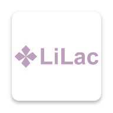

<h1 align="center">LilacAnime iOS</h1>

  
  
  
  

  
  

  <a href="https://github.com/dream150/LilacAnime">LilacAnime</a> Android 앱과 <a href="https://github.com/whispelyn-byte/LilacAnime-desktop">데스크탑 앱</a>을 iPhone · iPad로 옮긴 앱입니다. 
  여러 사이트의 애니를 한 화면에서 찾아 보고, 한국어 자막을 자동으로 찾아 입히고, 
  없으면 일본어·영어 자막을 한국어로 번역해 줍니다. 회차를 내려받아 오프라인에서도 볼 수 있습니다.

## 목차

- **시작하기**: [주요 기능](#주요-기능) · [설치](#설치) · [업데이트](#업데이트) · [처음 쓸 때](#처음-쓸-때)
- **사용법**
  - [애니 보기](#애니-보기)
  - [TMDB 키 넣기 (꼭 해 주세요)](#tmdb-키-넣기-꼭-해-주세요)
  - [자막 고르기 · 다시 번역](#자막-고르기--다시-번역)
  - [자막 크기 · 싱크 · 글꼴](#자막-크기--싱크--글꼴)
  - [번역 시작하기](#번역-시작하기)
  - [오프라인으로 보기](#오프라인으로-보기)
  - [PiP · 스크린샷 · TV로 보기](#pip--스크린샷--tv로-보기)
  - [데스크탑과 동기화](#데스크탑과-동기화)
- **자세한 설명**: [콘텐츠 소스](#콘텐츠-소스) · [자막](#자막) · [플레이어](#플레이어) · [다운로드](#다운로드)
- [문제 해결](#문제-해결) · [저장 위치](#저장-위치) · [개발](#개발) · [크레딧](#크레딧)

  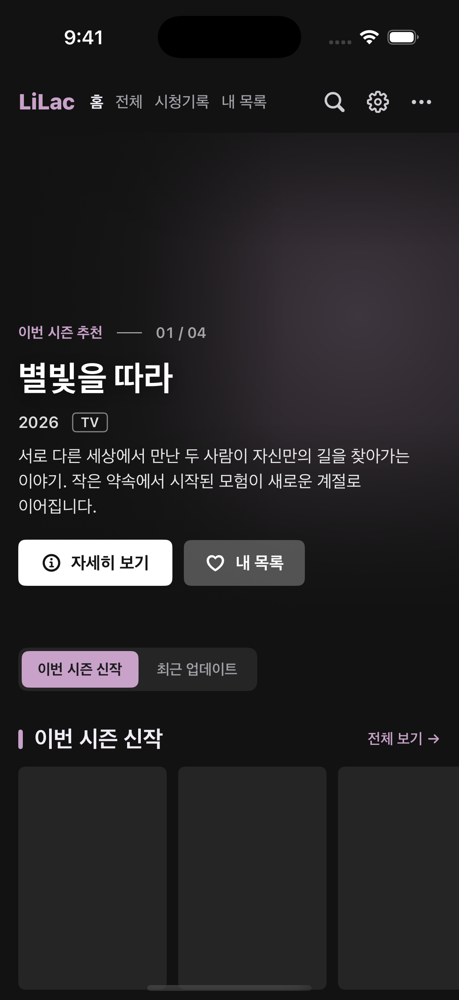
  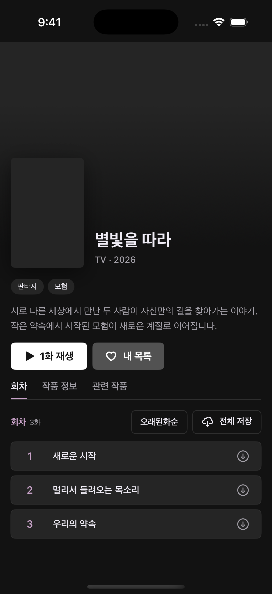
  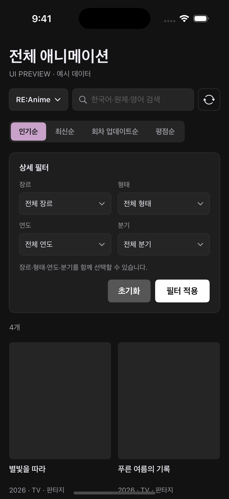

## 주요 기능

- **여러 사이트를 한 곳에서**: RE:Anime · Miruro · Animenosub · 애니24 · 링크애니 · Linkkf. 영어 제목 사이트도 한국어 제목으로 보여 주고 한국어로 검색합니다.
- **한국어 자막 자동**: 사이트의 한국어 트랙, Kairan · Csora · Anissia 블로그 자막을 알아서 찾아 입힙니다.
- **없으면 AI 번역**: Jimaku 일본어 자막이나 사이트의 일본어·영어 트랙을 번역 API(Gemini · OpenAI · DeepL · Qwen)나 기기 안의 로컬 AI(Gemma 4 · Aya · Hy-MT2)로 번역합니다. **보고 있는 장면부터 번역해 번역된 줄은 바로 한국어로** 바뀌고, 다음 화는 보는 동안 미리 번역해 둘 수 있습니다.
- **한국어 제목 · 줄거리**: 영어 사이트의 작품도 한국어 제목으로 보여 주고, TMDB 키가 있으면 줄거리도 한국어로 보여 줍니다.
- **자막과 함께 PiP · 스크린샷**: 작은 창(PiP)에서도 고른 자막이 그대로 나오고, 지금 장면을 원본 해상도로 사진 앱에 저장합니다.
- **OP/ED 건너뛰기 · 이어보기 · 다음 화 자동 재생 · 외부 키보드 단축키 · AirPlay · Chromecast**
- **다운로드**: 자막·OP/ED 구간까지 함께 저장해 오프라인에서도 그대로 봅니다. 백그라운드에서도 계속 받습니다.
- **데스크탑과 동기화**: 내 서버를 거쳐 내 목록과 시청 기록(이어 보기 위치 포함)을 데스크탑 앱과 맞춥니다.

| | |
|---|---|
| 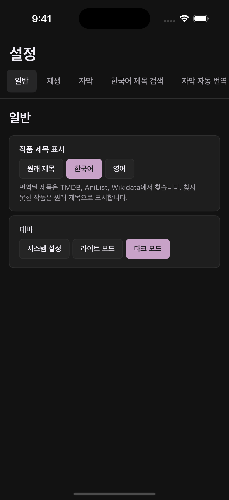 | 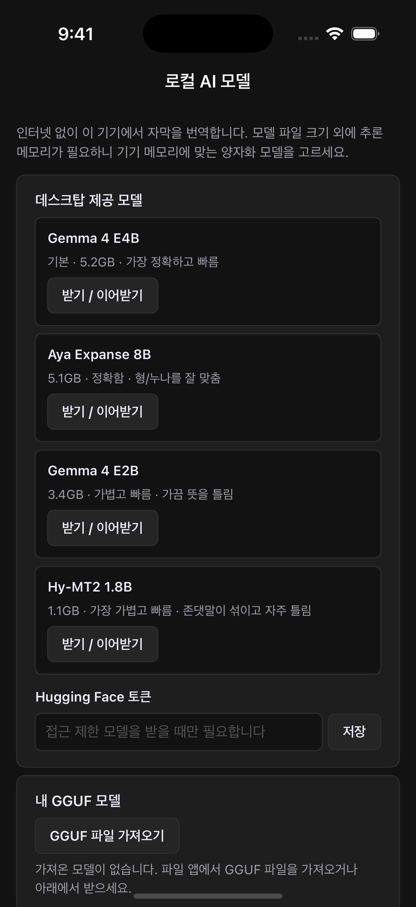 |
| **설정** · 분류를 고르고 항목별로 변경 | **설정 > 자막 자동 번역 > 로컬 GGUF 모델** |

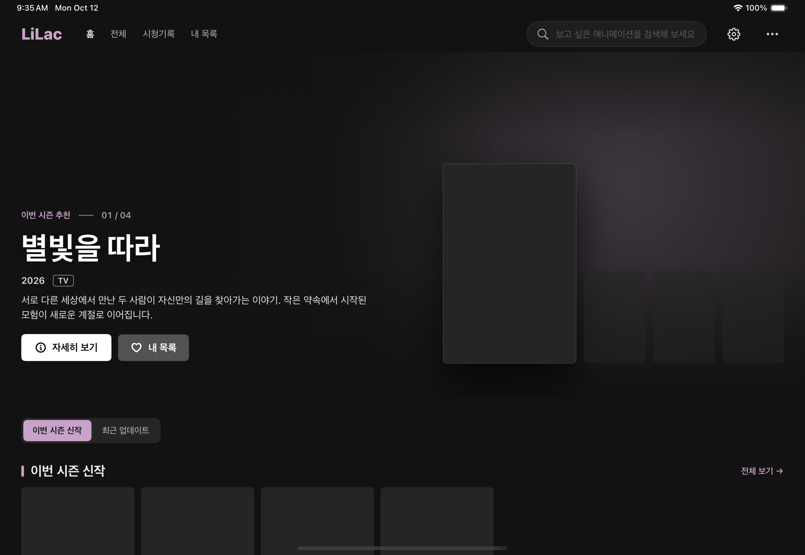

<b>iPad</b> · 상단 탐색 메뉴와 검색창, 넓은 홈 화면

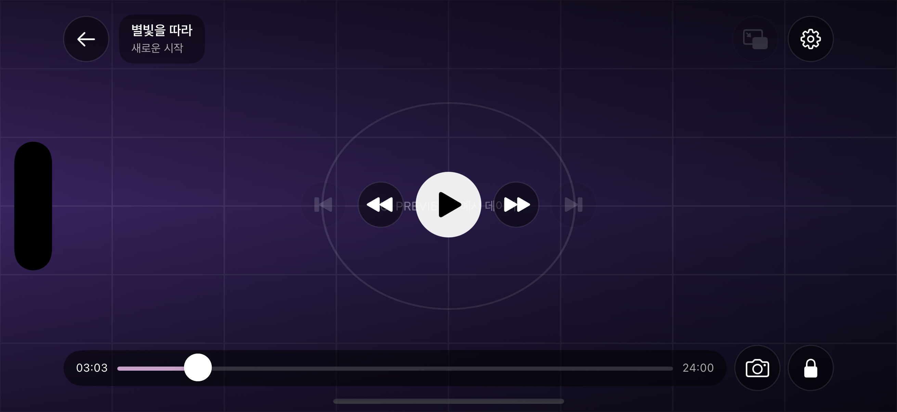

| 탭 | 설정 화면 |
|---|---|
| **재생** | 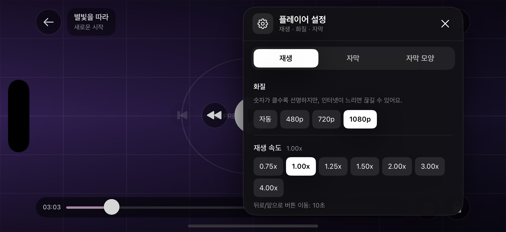 |
| **자막** | 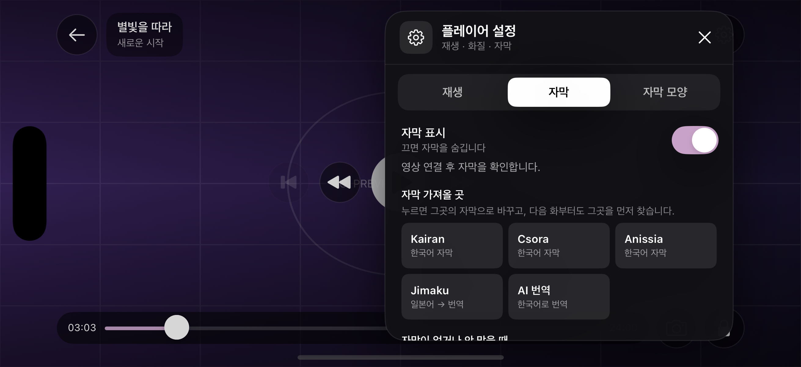 |
| **자막 모양** | 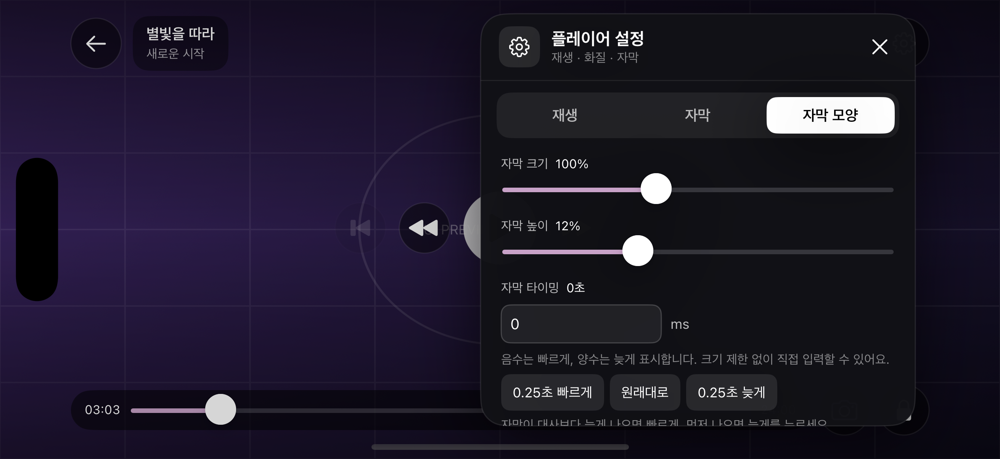 |

플레이어 설정은 화면 오른쪽 패널에서 **재생 · 자막 · 자막 모양** 탭으로 나뉩니다. 영상을 보면서 화질·배속·화면 맞춤, 자막 선택·번역, 글꼴·크기·싱크를 바꿀 수 있습니다.

홈 추천 전환, 화면·포스터·설정 패널 등장과 버튼 누름에는 짧은 애니메이션이 적용됩니다. iOS **설정 > 손쉬운 사용 > 동작 > 동작 줄이기**를 켜면 이동·확대 효과를 생략합니다.

화면은 `main` 브랜치의 앱을 iPhone · iPad 시뮬레이터에서 예시 데이터로 찍은 것입니다. 실제 작품 이미지가 아니며, 아직 릴리즈되지 않은 UI 변경이 포함될 수 있습니다. [캡처 기준과 다시 찍는 방법](docs/screenshots/README.md)

## 설치

App Store 앱이 아니라서 [SideStore](https://docs.sidestore.io/)로 설치합니다. iOS 16 이상이 필요합니다.

1. iPhone · iPad에 SideStore를 설치합니다 ([SideStore 설치 안내](https://docs.sidestore.io/docs/installation/prerequisites)).
2. **[LilacAnime IPA 받기](https://github.com/whispelyn-byte/LilacAnime-ios/releases/latest/download/LilacAnime-SideStore.ipa)**: 항상 최신 버전이 받아집니다. ([모든 릴리즈](https://github.com/whispelyn-byte/LilacAnime-ios/releases))
3. SideStore의 **My Apps → +**에서 받은 IPA를 고릅니다. SideStore가 내 Apple 계정으로 서명해 설치합니다.

IPA는 **압축을 풀지 않고** 그대로 고릅니다. 무료 Apple 계정으로 서명한 앱은 7일마다 SideStore에서 **Refresh**(인증 갱신)를 해야 계속 열립니다.

## 업데이트

SideStore의 **Sources → +**에 아래 주소를 넣으면, 새 버전이 나왔을 때 SideStore에서 바로 업데이트할 수 있습니다.

~~~text
https://github.com/whispelyn-byte/LilacAnime-ios/releases/latest/download/source.json
~~~

- 새 버전이 나오면 앱도 알려 줍니다. **설정 > 업데이트 · 정보**에서 설치 버전과 최신 릴리즈를 비교하고, 새 IPA를 받거나 **SideStore 소스 주소 복사**로 위 주소를 복사할 수 있습니다. 최신 버전이면 "최신 버전을 쓰고 있습니다"만 나옵니다. 설치는 SideStore에서 합니다.
- 업데이트하면 바뀐 점이 처음 한 번 표시됩니다.
- **기존 앱을 지우지 말고** 새 버전을 설치하세요. 지우면 내 목록 · 시청 기록 · 다운로드가 함께 지워집니다.
- **Refresh**(7일 인증 갱신)와 **새 버전 업데이트**는 다른 작업입니다.

## 처음 쓸 때

화면 위쪽의 **홈 · 전체 · 시청기록 · 내 목록**으로 이동합니다. iPhone은 돋보기 버튼으로 검색 화면을 열고, iPad는 상단 검색창에 바로 입력합니다. **톱니바퀴**는 설정, **더보기(···)**는 로컬 영상 열기와 영상 소스 선택입니다. iPhone에서 상단 항목이 다 보이지 않으면 가로로 밀어 볼 수 있습니다.

설정의 분류는 iPhone에서는 위쪽 가로 목록, iPad에서는 왼쪽 세로 목록에 표시됩니다. **자막 자동 번역 > 로컬 GGUF 모델**에서 돌아올 때는 화면 위의 뒤로 가기를 누릅니다.

1. **설정 > 재생 > 영상 소스**에서 볼 사이트를 고릅니다. 처음엔 RE:Anime입니다.
2. **설정 > 일반 > 작품 제목 표시**에서 한국어 / 영어 / 원래 제목을 고릅니다.
3. **(강력 추천) 설정 > 한국어 제목 검색**에 TMDB API 키를 넣습니다. 한국어 자막을 훨씬 많이 찾고, 제목 · 줄거리도 한국어로 나옵니다. → [TMDB 키 넣기](#tmdb-키-넣기-꼭-해-주세요)
4. (선택) 자막 번역을 쓰려면 **설정 > 자막 자동 번역**에서 번역 API(Gemini · OpenAI · DeepL · Qwen) 키를 넣거나 로컬 AI 모델을 받습니다. → [번역 시작하기](#번역-시작하기)

## 사용법

### 애니 보기

1. 위쪽 검색창에 제목을 한국어로 입력하고 검색합니다.
2. 또는 홈 맨 위의 **이번 시즌 추천**에서 고릅니다. iPhone에서는 추천 화면을 좌우로 밀고, 넓은 화면에서는 오른쪽 포스터를 눌러 작품을 바꿉니다. **자세히 보기**를 누르면 작품 화면이 열립니다. 이번 시즌 신작 · 인기 작품 · 방영 중을 둘러보다가 작품을 눌러도 됩니다.
3. **전체**에서는 소스의 모든 작품을 한국어 · 원제 · 영어로 검색하고, 장르 · 형태 · 연도 · 분기 필터와 인기순 · 최신순 · 회차 업데이트순 · 평점순 정렬로 찾아봅니다. 소스가 제공하는 분류만 나옵니다.
4. 홈의 **최근 업데이트**와 내 목록의 **회차 업데이트순**은 RE:Anime · Miruro · Animenosub · 애니24 · 링크애니에서 쓸 수 있습니다.

작품 화면에서:

1. **○화 재생**을 누르면 첫 화부터(본 적이 있으면 **이어보기**로 멈춘 곳부터) 재생합니다.
2. 보고 싶은 회차를 골라 눌러도 됩니다. 회차가 많으면 위쪽 범위 버튼으로 넘기고, **최신화순 / 오래된화순**으로 순서를 바꿉니다.
3. 회차 옆 버튼은 그 회차만 내려받고, **전체 저장**은 모든 회차를 내려받습니다. → [오프라인으로 보기](#오프라인으로-보기)
4. 하트를 누르면 **내 목록**에 담깁니다.

작품 화면의 **회차 · 작품 정보 · 관련 작품** 탭에서 회차 목록, 줄거리·작품 정보, 관련 작품을 나눠 볼 수 있습니다.

재생을 누르면 가로 전체 화면으로 바뀝니다. 자막은 앱이 알아서 찾아 입힙니다. 보다가 나가도 홈의 **계속 시청하기**나 **시청기록**에서 누르면 멈춘 곳부터 이어집니다.

### TMDB 키 넣기 (꼭 해 주세요)

**한국어 자막을 찾는 데 가장 중요한 설정입니다.** RE:Anime · Miruro · Animenosub는 작품 제목이 영어라서, 한국어 자막(Kairan · Csora · Anissia)을 찾으려면 그 작품의 한국어 제목을 알아야 합니다. TMDB 키가 있으면 훨씬 많은 작품의 한국어 제목을 찾아 한국어 자막이 더 많이 붙고, 제목과 줄거리도 한국어로 나옵니다.

키는 무료입니다. TMDB 신청 화면이 휴대폰에서는 잘 안 되니 PC 브라우저로 받는 것을 권합니다 (5분쯤).

**TMDB에서 키 받기:**

1. [themoviedb.org 가입](https://www.themoviedb.org/signup)을 하고, 받은 메일의 링크를 눌러 인증합니다.
2. 로그인한 뒤 [설정 > API](https://www.themoviedb.org/settings/api)로 갑니다.
3. API 키 만들기(Create / Request an API Key)를 누르고 **Developer**를 고른 뒤 이용 약관에 동의합니다.
4. 신청서를 채웁니다. 사용 용도는 개인(Personal), 앱 이름은 `LilacAnime`, 앱 주소는 아무 주소(예: 이 GitHub 주소), 설명은 "개인용 애니 제목 검색"처럼 쓰면 됩니다.
5. 발급된 **API 키**(영문 · 숫자 32자)나 그 아래 긴 **읽기 액세스 토큰**을 복사합니다. (PC에서 받았다면 메모 앱 · 메시지 등으로 휴대폰에 옮깁니다.)

**앱에 넣기:**

1. **설정 > 한국어 제목 검색**을 엽니다.
2. **API Key 또는 Read Access Token** 칸에 붙여 넣고 **TMDB 키 저장**을 누릅니다.
3. **TMDB 연결 테스트**로 키가 맞는지 확인할 수 있습니다.

키는 이 기기의 Keychain에만 저장됩니다. 앱은 한국어 제목을 **TMDB → AniList → Wikidata** 순으로 찾고, 키가 없으면 AniList와 Wikidata로만 찾습니다. **설정 > 한국어 제목 검색 > 한국어 전체 카탈로그 · 인덱스**에서 소스 전체 작품의 한국어 제목을 미리 모을 수 있습니다 (처음엔 몇 분 걸리고, 그동안에도 앱은 그대로 쓸 수 있습니다).

### 자막 고르기 · 다시 번역

1. 재생 화면 오른쪽 위의 **톱니바퀴(플레이어 설정)**를 누릅니다.
2. **자막** 탭을 엽니다.
3. **자막 가져올 곳:** Kairan · Csora · Anissia · Jimaku · AI 번역 중에서 고릅니다. 다른 회차 자막이 나오면 **AI 번역**을 누르면 이 회차에 맞는 번역 자막으로 바뀝니다. 고른 곳은 다음 화부터도 먼저 찾습니다.
4. **사이트 자막 트랙 (RE:Anime · Miruro):** 사이트가 주는 여러 언어 자막입니다. 영어 · 일본어 트랙을 골라 볼 수도 있습니다.
5. **한국어 자막 다시 찾기** · **자막 파일 열기**(파일 앱의 ASS · SSA · SRT · VTT · SMI, 압축 파일도 가능)

일본어 · 영어 자막이 떠 있거나 AI 번역 자막이 떠 있으면 **자막 표시** 아래에 번역 버튼이 나옵니다. AI 번역이 어색하면 **다시 번역**으로 처음부터 새로 번역합니다. 로컬 AI로 번역했다면 번역 API 쪽 버튼으로 바꿔 보면 더 자연스럽습니다. 회차에 저장된 자막은 같은 탭 아래 **이 회차에 저장한 자막**에서 다시 고르거나 공유할 수 있습니다.

### 자막 크기 · 싱크 · 글꼴

1. 플레이어 설정에서 **자막 모양** 탭을 엽니다.
2. **크기 · 높이:** 막대를 끌어 바꿉니다.
3. **자막 타이밍:** 자막이 대사보다 늦으면 **0.25초 빠르게**, 먼저 나오면 **0.25초 늦게**를 누르거나 밀리초 값을 직접 넣습니다 (음수는 빠르게, 양수는 늦게). 외부 키보드에서는 **Z** · **X**로 0.5초씩 바꿉니다.
4. **글꼴:** **글꼴 파일 선택**으로 파일 앱의 TTF · OTF · TTC 글꼴을 가져오면 자막이 그 글꼴로 나옵니다. 자막 파일에 글꼴이 들어 있으면 그 글꼴도 골라 쓸 수 있습니다.

노래 가사 · 간판 같은 ASS 특수 효과는 **원본 효과 그대로**를 끄면 일반 자막처럼 나옵니다. AI 번역 자막은 데스크탑처럼 원본 ASS 효과 없이 기본 글꼴로 나오고, 직접 정한 크기 · 테두리 · 높이는 그대로 적용됩니다.

### 번역 시작하기

한국어 자막이 없는 작품도 보려면 번역을 하나 준비해 둡니다. 둘 중 하나만 있으면 됩니다.

| | 번역 API (추천: Gemini) | 로컬 AI |
|---|---|---|
| 비용 | Gemini는 무료 사용량으로 충분 | 무료, 한도 없음 |
| 품질 · 속도 | 더 자연스럽고 빠름 | 조금 어색할 수 있고 느림 (기기 성능에 따라) |
| 필요한 것 | 인터넷, API 키 | 모델 파일 1~5GB, 넉넉한 기기 메모리 |

**Gemini 키로 시작하기 (무료, 약 1분):**

1. [Google AI Studio](https://aistudio.google.com/apikey)에 구글 계정으로 로그인하고 **Create API key**를 눌러 키를 만든 뒤 복사합니다.
2. **설정 > 자막 자동 번역**에서 **공급자**를 Gemini로 고르고, **API Key**에 붙여 넣은 뒤 **키 저장**을 누릅니다. 사용할 수 있는 모델 목록이 나오면 끝입니다.

**로컬 AI로 시작하기:**

1. **설정 > 자막 자동 번역 > 로컬 GGUF 모델**을 엽니다.
2. 기기 메모리에 맞는 모델의 **받기**를 누릅니다. 다 받으면 **사용**을 눌러 고릅니다. 받기는 백그라운드에서도 계속되고, 중단했다가 이어받을 수 있습니다.
3. iPhone은 메모리가 작아 **Hy-MT2 1.8B**처럼 작은 모델부터 써 보는 것을 권합니다. 큰 모델은 기기에 따라 불러오지 못할 수 있습니다.

**자막 자동 번역**은 처음부터 켜져 있어서, 준비가 되면 한국어 자막이 없는 회차를 열기만 하면 됩니다. 보고 있는 장면부터 번역해서, 몇 초 뒤면 대사가 한국어로 바뀝니다. 한 번 번역한 회차는 저장되어 다음엔 바로 나옵니다. 자세한 내용은 [자막](#자막)에 있습니다.

### 오프라인으로 보기

작품 화면에서 회차 옆 버튼이나 **전체 저장**으로 받은 회차는 **내 목록 > 다운로드 완료**에 작품별로 모입니다. 인터넷 없이도 자막까지 그대로 나옵니다.

- 받는 중에는 진행률과 속도가 보이고, 앱을 내려도 iOS가 허락하는 동안 계속 받습니다. 멈춘 회차는 **다시 시도** · **이어 받기**로 이어서 받습니다.
- 받은 회차의 자막도 같이 저장되고, 설정에 따라 한국어로 번역해 둡니다. 같은 작품을 두 화 이상 받으면 OP/ED 구간을 찾아 건너뛸 수 있게 합니다.
- **다운로드 폴더 내보내기 · 가져오기**로 받은 회차를 파일 앱의 폴더로 옮기거나, 데스크탑 앱에서 받은 회차(`downloads.json`과 작품 폴더)를 가져올 수 있습니다.

### PiP · 스크린샷 · TV로 보기

- **자막과 함께 PiP:** 재생 화면 위쪽의 PiP 버튼을 누르면 작은 창으로 바뀝니다. 고른 자막(번역 자막 포함)이 작은 창에도 그대로 나오고, 작은 창에서 재생 · 일시정지 · 10초 이동을 할 수 있습니다.
- **스크린샷:** 아래쪽 카메라 버튼(외부 키보드 **P**)을 누르면 지금 장면을 영상 원본 해상도의 PNG로 **사진 앱**에 저장합니다. 자막과 버튼은 찍히지 않습니다. 처음 저장할 때 사진 추가 권한을 묻습니다.
- **AirPlay · Chromecast:** 플레이어 설정 > 재생 > **저장 · 연결**에서 연결합니다. Chromecast로 보낼 때는 고른 자막을 함께 보냅니다 (ASS 효과는 빠지고 일반 자막으로 나옵니다). Cast 중계 중에는 앱을 재생 화면에 둡니다.

### 데스크탑과 동기화

**내 목록**과 **시청 기록**(이어 보기 위치 포함)을 데스크탑 앱과 맞춥니다. 데이터는 내가 직접 만든 서버에만 저장됩니다.

1. **서버 만들기 (한 번만):** [LilacAnime 서버](https://github.com/whispelyn-byte/LilacAnime-server)를 내 Vercel 계정에 배포하고, Upstash Redis를 연결한 뒤 비밀번호(**LILAC_PASSWORD**, 8자 이상)를 정합니다. 자세한 방법은 서버 저장소의 README에 있습니다.
2. **설정 > 일반 > 기기 동기화**를 엽니다.
3. **서버 주소**(`https://내-서버.vercel.app`)와 **비밀번호**를 넣고 **연결**을 누릅니다. 데스크탑 앱에도 같은 주소와 비밀번호를 넣으면 됩니다.

연결하면 앱을 열 때, 다시 앞으로 가져올 때, 5분마다, 내 목록이나 시청 기록이 바뀐 뒤에 저절로 맞춥니다. 같은 항목을 두 기기에서 바꾸면 나중에 바꾼 쪽이 남습니다. 이 기기의 파일로 본 기록은 보내지 않습니다. 서버 비밀번호를 바꾸면 연결이 끊기니 새 비밀번호로 다시 연결하세요.

## 콘텐츠 소스

| 소스 | 목록·검색 | 영상 | 자막 |
|---|---|---|---|
| **RE:Anime** | 한국어 검색, 상세 필터 | 자막 없는 영상. 응답이 느린 서버는 6초 뒤 다음 서버를 함께 시도 | 사이트의 여러 언어 자막 트랙 (한국어 트랙이 있으면 자동 적용) |
| **Miruro** | 한국어 검색, 회차 제목·방영일 | 서버 선택: SUB · RAW · SOFT · DUB | SOFT 서버의 여러 언어 자막 트랙 |
| **Animenosub** | 한국어 검색 | 서버 선택: SUB · RAW | 한국어 자막은 온라인 검색 |
| **애니24** ([ani.ohli24.com](https://ani.ohli24.com)) | 한국어 목록·검색 | 대부분 한국어 자막이 영상에 들어 있음 | 영상에 박힌 한국어 자막, 자막이 없는 원본 영상은 사이트 플레이어의 한국어 자막 파일 |
| **링크애니** ([linkani.tv](https://linkani.tv)) | 한국어 목록·검색 | 대부분 한국어 자막이 영상에 들어 있음 | 영상에 박힌 한국어 자막, 일부는 사이트의 자막 파일 |
| **Linkkf** | 한국어 목록, 요일별 방영표 | 사이트 기본 영상 | 사이트의 한국어 자막 |

- 영어 제목인 사이트(RE:Anime · Miruro · Animenosub)도 한국어 제목으로 보여 주고 한국어로 검색할 수 있습니다. 2기 이후 시즌은 "○○ 2기"처럼 표시합니다.
- **영상 서버 (Miruro · Animenosub):** 한국어 자막이 있으면 자막 없는 영상(RAW / SOFT)에 한국어 자막을, 없으면 영어 자막이 박힌 SUB를 고릅니다. 플레이어 설정 > 재생 > **영상 서버 · 화질**에서 직접 고를 수도 있고, 고른 서버는 다음 회차에도 유지됩니다.
- 영상이 안 나오면 **웹 플레이어 열기**로 사이트 화면에서 직접 재생할 수 있습니다.

## 자막

자막은 **사이트의 한국어 트랙 → 블로그 자막(Kairan · Csora · Anissia) → 번역** 순서로 자동으로 고릅니다. 기본 순서는 **설정 > 자막 > 기본 자막 소스**에서 바꿉니다 (**직접 선택**으로 두면 자동으로 찾지 않습니다).

- **블로그 자막:** 작품의 한국어 제목으로 블로그 글을 찾아, 회차 번호(시즌을 이어 센 번호 포함)에 맞는 첨부 파일을 받습니다. Google Drive · ZIP · 7z · RAR 압축과 자막에 딸린 글꼴도 처리합니다. Anissia는 자막 제작자별로 골라 볼 수 있습니다.
- **Jimaku:** 일본어 자막입니다. 번역 원문으로 쓰이고, 직접 골라 볼 수도 있습니다. 같은 작품에서 고른 파일은 다음 화에도 먼저 고릅니다.
- **번역:** 한국어 자막이 없으면 Jimaku 일본어 자막이나 사이트의 일본어 · 영어 트랙을 번역합니다. 등장인물 이름은 작품 정보에서 가져와 맞춰 쓰고, **설정 > 자막 자동 번역**의 용어집(`원문=한국어`)으로 직접 정할 수도 있습니다.
  - 번역 API가 실패하면 등록한 다른 API로, 그것도 안 되면 로컬 AI로 이어서 번역합니다 (각각 설정에서 끌 수 있습니다).
  - 중간에 멈춘 번역은 다음에 이어서 하고, 번역된 결과는 회차별로 저장됩니다.
  - **다음 화 미리 번역:** 로컬 AI는 기본으로 켜져 있고, 번역 API로 미리 번역하려면 따로 켭니다 (사용량을 씁니다).

## 플레이어

| 조작 | 동작 |
|---|---|
| 영상 한 번 탭 | 조작 버튼 표시 · 숨김 |
| 영상 꾹 누르기 | 누르는 동안 2배속 |
| 왼쪽 / 오른쪽 더블탭 | 설정한 시간만큼 뒤로 / 앞으로 |
| 가운데 더블탭 · 재생 버튼 | 재생 · 일시정지 |
| 잠금 버튼 | 실수로 누르지 않게 화면 잠금 |
| OP/ED 건너뛰기 버튼 | 오프닝 · 엔딩 구간에서 표시 (자동 건너뛰기는 설정에서) |

**외부 키보드 (iPad 등):**

| 키 | 동작 |
|---|---|
| Space | 짧게: 재생 · 일시정지, 길게: 누르는 동안 2배속 |
| ← · → | 뒤로 · 앞으로 탐색 |
| ↑ · ↓ · M | 음량 · 음소거 |
| C | 자막 켜기 / 끄기 |
| Z · X | 자막 싱크 0.5초 빠르게 / 늦게 |
| S | OP/ED 건너뛰기 (구간이 나올 때) |
| P | 스크린샷 (사진 앱) |
| [ · ] | 재생 속도 한 단계 느리게 · 빠르게 |
| 0–9 | 회차의 0–90% 위치로 |
| PageUp · PageDown · Esc | 이전 화 · 다음 화 · 나가기 |

- **화면 비율 · 맞춤:** 플레이어 설정 > 재생에서 원본 · 16:9 · 21:9 · 4:3 · 화면 채움, 그리고 맞춤(원본 비율) · 채움(가장자리 자르기) · 늘림을 고릅니다.
- **이어보기:** 마지막에 본 위치부터 재생합니다 (95% 이상 봤으면 처음부터).
- **백그라운드 재생:** 앱을 내려도 소리가 계속 나오고, 잠금 화면 · 제어 센터에서 조작할 수 있습니다 (**설정 > 재생 > 백그라운드 오디오**).
- 재생 중에는 화면이 꺼지지 않고, 일시정지하면 다시 자동 잠금이 됩니다.

## 다운로드

- 받은 회차는 앱 안에 저장되고 **내 목록 > 다운로드 완료**에서 재생 · 삭제합니다. 작품별로 묶여서 **전체 중지 · 이어 받기 · 전체 삭제**를 한 번에 할 수 있습니다.
- **목록 비우기 · 파일 보존**은 목록만 비우고 파일은 남기며, **보존한 다운로드 다시 찾기**로 다시 불러옵니다.
- **설정 > 재생**에서 다운로드에 자막을 포함할지, 받은 자막을 번역할지 정합니다. 저장 공간이 부족하면 [문제 해결](#문제-해결)을 보세요.

## 문제 해결

**영상이 안 나오거나 계속 불러오기만 해요**
- 사이트 서버가 멈춘 경우가 많습니다. **다시 시도**를 누르거나, **설정 > 재생 > 콘텐츠 / 영상 소스**를 바꿔 다른 사이트에서 찾아봅니다. 상단 **더보기(···) > 영상 소스**에서도 바꿀 수 있습니다.
- 플레이어 설정 > 재생 > **영상 서버 · 화질**에서 다른 서버나 낮은 화질을 골라 봅니다. **웹 플레이어 열기**로 사이트 화면에서 재생할 수도 있습니다.

**한국어 자막을 못 찾아요**
- **설정 > 한국어 제목 검색**에 TMDB 키를 넣으면 훨씬 많이 찾습니다 → [TMDB 키 넣기](#tmdb-키-넣기-꼭-해-주세요)
- 플레이어 설정 > 자막 > **한국어 자막 다시 찾기**를 눌러 봅니다. **자막 직접 검색 · 다시 번역**에서 검색 제목을 바꿔 찾을 수도 있습니다. 그래도 없으면 번역 자막이 대신 나옵니다 ([번역 시작하기](#번역-시작하기)).

**번역이 안 돼요**
- **설정 > 자막 자동 번역**에 키가 저장되어 있는지, **자막 자동 번역**이 켜져 있는지 확인합니다. **API 연결 테스트 · 모델 목록**으로 키를 확인할 수 있습니다.
- Gemini 무료 사용량을 다 쓰면 다른 API나 로컬 AI가 이어받습니다 (등록해 둔 경우). 무료 사용량은 다음 날(한국 시간 오후 4~5시쯤) 다시 채워집니다.

**로컬 AI 모델을 불러오지 못해요**
- 기기 메모리보다 큰 모델입니다. 더 작은 모델(Hy-MT2 1.8B 등)로 바꿉니다. **Metal GPU 사용**을 꺼서 CPU로 돌려 볼 수도 있습니다 (느립니다).

**SideStore에서 앱이 열리지 않아요**
- 7일 인증이 끝난 경우입니다. SideStore에서 **Refresh**를 누릅니다. 설치가 안 되면 [SideStore 문제 해결 안내](https://docs.sidestore.io/docs/troubleshooting)를 봅니다.

**저장 공간이 부족해요**
- **설정 > 업데이트 · 정보 > 저장 자막 · 캐시 관리**에서 쓰지 않는 자막과 번역 캐시를 지웁니다 (저장한 자막과 지금 쓰는 자막은 남깁니다).
- 받은 회차는 **내 목록 > 다운로드 완료**에서 지우거나, **다운로드 폴더 내보내기**로 다른 곳에 옮긴 뒤 지웁니다.

## 저장 위치

| 내용 | 위치 |
|---|---|
| 내 목록 · 시청 기록 · 설정, 다운로드한 회차, 자막 · 번역, 로컬 AI 모델 | 앱 내부 (앱을 지우면 함께 지워짐) |
| API 키 · TMDB 키 · 동기화 토큰 | 이 기기의 Keychain |
| 로컬 영상 열기로 가져온 영상, 받은 IPA | 파일 앱 > 나의 iPhone(iPad) > LilacAnime |
| 스크린샷 | 사진 앱 |

API 키는 이 기기에만 저장되고, 각 키는 그 서비스 요청에만 씁니다. 기기 동기화를 켜면 내 목록과 시청 기록만 내가 연결한 서버로 보냅니다. 서버 비밀번호는 저장하지 않고 서버가 준 토큰만 Keychain에 둡니다.

## 개발

현재 버전은 **0.4.6**입니다. 바뀐 점은 [릴리즈 노트](docs/release-notes.md)에 있습니다.

공통 코드(Kotlin Multiplatform) 테스트는 JDK 17로 실행합니다.

~~~sh
sh ./gradlew :shared:jvmTest
~~~

iOS 빌드와 전체 검증은 Apple Silicon Mac, Xcode, JDK 17, XcodeGen이 필요합니다.

~~~sh
brew install xcodegen
sh iosApp/scripts/verify.sh
~~~

GitHub Actions가 공통 테스트, KMP iOS 테스트, 네이티브 iOS 테스트, iPhone · iPad UI 검사, 서명하지 않은 IPA 패키징을 실행합니다. 화면 캡처는 **Run workflow → capture_previews**를 켰을 때 만들고, 로컬에서는 `CAPTURE_PREVIEWS=0 sh iosApp/scripts/verify.sh`로 생략할 수 있습니다.

**릴리즈:** 버전은 `iosApp/version.txt`에 있고, 릴리즈마다 올립니다. 태그와 릴리즈 노트 제목도 버전만 씁니다(`v0.4.6`, `# 0.4.6`). SideStore가 업데이트를 알아보는 내부 빌드 번호는 Android versionCode에 `iosApp/revision.txt`를 더한 값이라 이것도 함께 1씩 올립니다. `version.txt` · `revision.txt` · `iosApp/project.yml`과 `docs/release-notes.md`의 새 항목을 맞춘 뒤 `python3 iosApp/scripts/android-version.py --check --release-tag v<버전>`으로 확인하고, 그 태그를 푸시하면 모든 검사가 통과한 뒤 IPA와 SideStore `source.json`이 릴리즈에 올라갑니다.

| 경로 | 내용 |
|---|---|
| `shared/` | Kotlin Multiplatform: 소스 파싱, 자막 검색 · 매칭, 번역 요청, 공통 규칙 |
| `iosApp/LilacAnime/` | SwiftUI 화면, mpv 플레이어, 다운로드, PiP, Cast, 로컬 AI 연결 |
| `iosApp/Native/` | llama.cpp · libarchive 연결 ([의존성 · 라이선스](iosApp/Native/README.md)) |
| `iosApp/scripts/` | 검증, IPA 패키징, SideStore 소스 · 릴리즈 노트 생성 |
| `.github/workflows/kmp.yml` | 테스트 · 빌드 · 태그 릴리즈 |
| [`docs/desktop-port.md`](docs/desktop-port.md) | 데스크탑 기능 이식 범위와 플랫폼 차이 |

## 크레딧

- 원본 Android 앱: [dream150/LilacAnime](https://github.com/dream150/LilacAnime)
- 데스크탑 앱: [whispelyn-byte/LilacAnime-desktop](https://github.com/whispelyn-byte/LilacAnime-desktop)
- 재생: [mpv](https://github.com/mpv-player/mpv) · [MPVKit](https://github.com/mpvkit/MPVKit)
- 자막: Kairan · Csora · Anissia · [Jimaku](https://jimaku.cc)
- 로컬 AI: [llama.cpp](https://github.com/ggml-org/llama.cpp) · [nlohmann/json](https://github.com/nlohmann/json)
- 압축 자막: [libarchive](https://github.com/libarchive/libarchive)
- OP/ED 구간: [AniSkip](https://aniskip.com)
- 한국어 제목: [TMDB](https://www.themoviedb.org) · [AniList](https://anilist.co) · [Wikidata](https://www.wikidata.org). This product uses the TMDB API but is not endorsed or certified by TMDB.

원본과 각 의존성의 라이선스 조건을 따릅니다.
